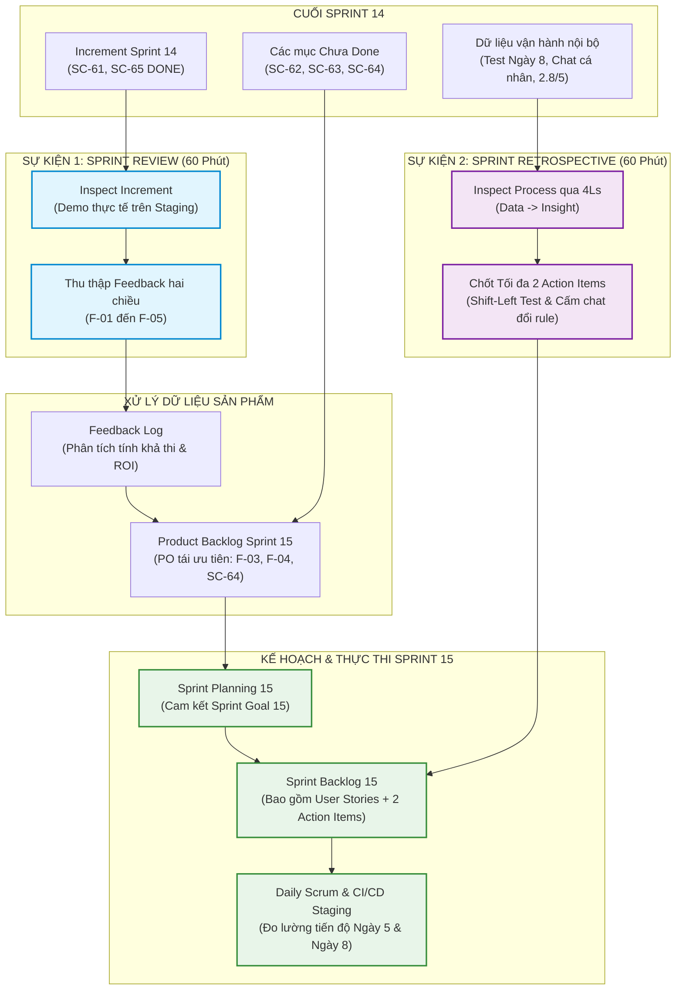

# [BÀI TẬP TỔNG HỢP] THIẾT KẾ INSPECT & ADAPT EVENT PACK CHO SHOPCARE AI

**Môn học:** [IT-206-K25] Quy trình phát triển phần mềm với Agile/Scrum  
**Session 09:** Inspect & Adapt: Sprint Review, Sprint Retrospective & Continuous Improvement  
**Đơn vị thực hiện:** Nhóm Scrum ShopCare AI - Học viên Rikkei Academy  
**Phiên bản:** 1.0 (Áp dụng từ chuyển giao Sprint 14 sang Sprint 15)  

---

## 1. Tổng quan & Thiết lập bối cảnh (Context & Ground Rules)

### 1.1. Bối cảnh dự án ShopCare AI cuối Sprint 14
Dự án **ShopCare AI** là nền tảng trợ lý thông minh hỗ trợ chăm sóc khách hàng (CSKH) đa kênh tự động. Cuối Sprint 14, hệ thống bộc lộ hai vấn đề nghiệp vụ nghiêm trọng:
1. **Phân loại sai khiếu nại:** AI nhầm lẫn giữa các nhóm khiếu nại khẩn cấp và khiếu nại thông thường, dẫn đến chậm trễ điều phối.
2. **Thiếu lịch sử tương tác đa kênh:** Điện thoại viên CSKH khi nhận cuộc gọi/hội thoại do AI chuyển tiếp không nắm được ngữ cảnh trao đổi trước đó của khách trên các kênh Chat/Zalo/Web.

Mặt khác, quy trình thực thi Scrum tại Sprint 14 bị biến dạng nghiêm trọng:
- **Sprint Review** bị biến thành một buổi "nghiệm thu một chiều" (Sign-off gate), nơi Product Owner (PO) tuyên bố toàn bộ công việc đều "Xong" (Done), che giấu các lỗi kỹ thuật và vội vã hứa hẹn thực hiện mọi yêu cầu phát sinh từ phía các bên liên quan (Stakeholders).
- **Sprint Retrospective** sa đà vào văn hóa đổ lỗi cá nhân (Blame game), giải pháp bị PO áp đặt đơn phương từ trên xuống, các Action Item được tạo ra một cách mơ hồ hoặc nhắm vào cá nhân mà không giải quyết được lỗ hổng quy trình cốt lõi.

### 1.2. Mục tiêu Sprint 15 & Khung nguyên tắc vận hành
Nhóm Scrum đóng vai trò tái cấu trúc toàn diện hai sự kiện **Sprint Review** và **Sprint Retrospective** cho Sprint 15 với các tham số ràng buộc sau:

| Thuộc tính | Quy định thiết kế bắt buộc |
| :--- | :--- |
| **Sprint Goal Sprint 15** | *"CSKH nhận hội thoại AI không xử lý trong 2 phút, kèm trạng thái đơn và lịch sử tương tác đa kênh."* |
| **Timebox sự kiện** | **Sprint Review:** 60 phút.<br>**Sprint Retrospective:** 60 phút (tổ chức ngay sau Review; **tuyệt đối không mời Quản lý vận hành** hay Stakeholders bên ngoài). |
| **Definition of Done (DoD)** | 1. Đã triển khai và hoạt động ổn định trên môi trường **Staging**.<br>2. Toàn bộ **kiểm thử quan trọng (Critical/Key tests)** đều đạt (Pass).<br>3. **Không còn bất kỳ lỗi mức độ Cao (High) hoặc Nghiêm trọng (Critical)** nào tồn đọng.<br>4. **Đạt kiểm tra quyền riêng tư (Privacy & PII Compliance check)**. |
| **Giới hạn & Nguyên tắc vàng** | - **Tách biệt rạch ròi:** Review kiểm tra sản phẩm (Product/Increment); Retro cải tiến cách làm việc nội bộ (People/Process). Không gộp hai sự kiện làm một.<br>- **Feedback chưa phải là cam kết:** Mọi phản hồi tại Review là dữ liệu đầu vào cho Product Backlog, không hứa hẹn làm ngay.<br>- **Tối đa 2 Action Items:** Retro chỉ chọn tối đa 2 hành động cải tiến cốt lõi, có người theo dõi, thời điểm và bằng chứng đo lường.<br>- **Không can thiệp sâu kỹ thuật:** Không yêu cầu trực tiếp code/API/CSDL, tập trung vào thiết kế quy trình và tương tác con người. |

---

## 2. Kiểm tra Increment & Đánh giá hiện trạng Sprint 14

### 2.1. Bảng đối chiếu Increment cuối Sprint 14 theo Definition of Done (DoD)

Mỗi Product Backlog Item (PBI) chỉ được coi là hoàn thành (Done) khi và chỉ khi thỏa mãn đồng thời cả 4 tiêu chí của Definition of Done. Bất kỳ hạng mục nào vi phạm dù chỉ 1 tiêu chí đều phải bị coi là **Chưa Done (Not Done)**.

| Mã PBI | Tên hạng mục tính năng | Bằng chứng thực tế cuối Sprint 14 | Staging | Kiểm thử quan trọng | Lỗi cao / Nghiêm trọng | Quyền riêng tư (Privacy) | Kết luận trạng thái |
| :---: | :--- | :--- | :---: | :---: | :---: | :---: | :---: |
| **SC-61** | Nhận diện ý định khiếu nại cơ bản | 80/80 kiểm thử đạt; không còn lỗi cao | Đạt | Đạt (80/80) | Đạt (0 lỗi) | Đạt | **DONE** |
| **SC-62** | Tích hợp dịch vụ tra cứu đơn hàng | 70/78 đạt; còn 8 ca lỗi dịch vụ đơn hàng | Đạt | **Không đạt** (70/78) | **Không đạt** (8 ca lỗi) | Đạt | **CHƯA DONE** |
| **SC-63** | Phân loại khiếu nại mức độ nghiêm trọng | 74/80 ca đúng; còn 1 lỗi nghiêm trọng cao | Đạt | **Không đạt** (74/80) | **Không đạt** (Còn 1 lỗi cao) | Đạt | **CHƯA DONE** |
| **SC-64** | Điều hướng cuộc gọi sang CSKH trong 2 phút | 60/60 kiểm thử chính đạt; đang chờ kiểm tra che SĐT | Đạt | Đạt (60/60) | Đạt (0 lỗi cao) | **Không đạt** (Chưa che SĐT) | **CHƯA DONE** |
| **SC-65** | Bảo mật mã hóa thông tin thanh toán | 42/42 đạt; kiểm tra quyền riêng tư đạt | Đạt | Đạt (42/42) | Đạt (0 lỗi) | Đạt | **DONE** |

> [!IMPORTANT]
> **Tổng kết Increment Sprint 14:**
> - **Phần Done (Đạt chuẩn phát hành):** Chỉ có **SC-61** và **SC-65** được đưa vào Increment chính thức để trình diễn tại Sprint Review. Chỉ 2 hạng mục này được tính vào Velocity của nhóm.
> - **Phần Chưa Done (Chưa hoàn thành):** **SC-62, SC-63, SC-64**. Không được gộp vào Increment, không được phát hành lên Production và không được tính bất kỳ điểm Velocity nào.

### 2.2. Chiến lược minh bạch & Cách trình bày phần Chưa Done tại Sprint Review
Việc ứng xử với các hạng mục chưa Done phản ánh tính minh bạch (Transparency) và lòng dũng cảm (Courage) của Scrum Team:
1. **Không che giấu hoặc nói giảm nói tránh:** PO và Developers công khai danh sách SC-62, SC-63, SC-64 là "Chưa Done" ngay tại phần đầu buổi Review, trước khi tiến hành demo các tính năng Done.
2. **Tuyệt đối không Demo tính năng chưa hoàn thành:** Không trình diễn SC-62, SC-63, SC-64 như thể chúng đã sẵn sàng sử dụng. Việc demo tính năng lỗi sẽ gây hiểu lầm cho Stakeholders rằng sản phẩm có thể triển khai ngay.
3. **Trình bày rõ rủi ro kỹ thuật và nguyên nhân:**
   - *SC-62:* Còn 8 ca lỗi kết nối dịch vụ đơn hàng, nếu dùng sẽ khiến điện thoại viên không lấy được trạng thái đơn thật của khách.
   - *SC-63:* Còn 1 lỗi nghiêm trọng cao dẫn đến phân loại sai lệch ca khiếu nại khẩn cấp.
   - *SC-64:* Chưa hoàn tất kiểm tra che số điện thoại (PII), nếu phát hành sẽ vi phạm chính sách bảo mật dữ liệu khách hàng.
4. **Hành động chuyển giao:** Toàn bộ phần việc chưa hoàn thành được đưa ngược trở lại **Product Backlog**. PO cùng nhóm sẽ tái ước lượng (Re-estimate), phân tích lại độ ưu tiên và xem xét đưa vào Sprint Backlog của Sprint 15.

### 2.3. Phân tích 02 điểm sai lầm nghiêm trọng của Sprint Review cũ và tác động

#### Sai lầm 1: Đánh đồng tính năng dở dang là "Done" và biến Review thành buổi "Nghiệm thu một chiều" (Sign-off Gate)
- **Hành vi sai trái:** PO tuyên bố cả 5 mã SC-61 đến SC-65 đều Done, ép Quản lý CSKH và Stakeholders "ký biên bản nghiệm thu" thay vì cùng nhau thanh tra hiện trạng sản phẩm thực tế.
- **Tác động tiêu cực:**
  - *Tích tụ nợ kỹ thuật (Technical Debt) & Rủi ro pháp lý:* Việc lờ đi việc chưa che SĐT (SC-64) và 8 lỗi đơn hàng (SC-62) khiến sản phẩm có nguy cơ rò rỉ dữ liệu cá nhân (vi phạm luật an toàn thông tin) và làm sập luồng điều phối khi vận hành thực tế.
  - *Phá hủy tính minh bạch và tạo tiến độ ảo:* Đội ngũ ngộ nhận rằng mình đã hoàn thành 100% kế hoạch, che lấp các vấn đề về chất lượng code và năng lực kiểm thử.
  - *Đánh mất sự hợp tác của Stakeholders:* Stakeholders bị đặt vào thế bị động "phải nhận hàng", không có cơ hội đóng góp ý kiến thực chất, dẫn đến sự đối kháng giữa bộ phận Vận hành và bộ phận Công nghệ.

#### Sai lầm 2: Product Owner cam kết bừa bãi ("Hứa làm mọi Feedback") ngay tại cuộc họp
- **Hành vi sai trái:** Trước các ý kiến phản ánh của Stakeholders (F-01 đến F-05), PO vội vã gật đầu cam kết: *"Nhóm sẽ làm hết toàn bộ các yêu cầu này trong Sprint 15"*.
- **Tác động tiêu cực:**
  - *Phá vỡ Sprint Goal và quá tải hệ thống (Scope Creep):* Đội ngũ phát triển bị đẩy vào tình thế bị ép buộc thực hiện khối lượng công việc khổng lồ mà không qua phân tích khả thi kỹ thuật.
  - *Biến Product Backlog thành "thùng rác chứa việc":* Bỏ qua quy trình phân tích giá trị nghiệp vụ (Business Value) và hoàn vốn đầu tư (ROI). Những yêu cầu chưa rõ ràng như "Tự động hóa 90%" (F-01) sẽ hút cạn nguồn lực của nhóm.
  - *Đánh mất uy tín của PO và Scrum Team:* Khi bước vào Sprint 15, nhóm chắc chắn sẽ vỡ trận và không thể giao nộp toàn bộ các lời hứa, làm xói mòn nghiêm trọng niềm tin của các cấp quản lý vào cam kết của Scrum Team.

---

## 3. Thiết kế Sprint Review (60 phút) & Feedback Log

Sprint Review là sự kiện **thanh tra và thích ứng sản phẩm (Inspect & Adapt Product)**, mang tính chất cộng tác hai chiều, không phải buổi báo cáo hay nghiệm thu bàn giao.

### 3.1. Kế hoạch Agenda chi tiết 60 phút

| Khung thời gian | Thời lượng | Nội dung hoạt động chi tiết | Người chủ trì | Mục tiêu đầu ra |
| :---: | :---: | :--- | :---: | :--- |
| **00:00 - 00:05** | 5 phút | **Khai mạc & Nhắc lại mục tiêu:**<br>- Chào mừng Stakeholders, nêu rõ mục đích buổi làm việc là thanh tra và thu thập phản hồi hai chiều.<br>- Nhắc lại **Sprint Goal Sprint 14** và giới hạn phạm vi làm việc. | **PO** | Tạo không khí cởi mở, minh bạch; thiết lập tâm thế cộng tác. |
| **00:05 - 00:15** | 10 phút | **Báo cáo hiện trạng Increment theo Definition of Done:**<br>- Trình bày danh sách hạng mục: Công bố SC-61, SC-65 **Done**; SC-62, SC-63, SC-64 **Chưa Done**.<br>- Giải thích thẳng thắn các rào cản kỹ thuật (lỗi dịch vụ, chưa che SĐT). | **PO & Devs** | Stakeholders nắm rõ thực trạng khách quan; minh bạch 100% dữ liệu. |
| **00:15 - 00:35** | 20 phút | **Trải nghiệm thực tế & Trình diễn tương tác (Interactive Demo):**<br>- Trình diễn trực tiếp trên môi trường **Staging** các tính năng Done (SC-61 nhận diện ý định, SC-65 mã hóa thanh toán).<br>- Mời đại diện CSKH trực tiếp thao tác thử nghiệm kịch bản phân luồng hội thoại. | **Developers & Stakeholders** | Stakeholders được trực tiếp sờ, thử và cảm nhận giá trị thực tế của Increment. |
| **00:35 - 00:50** | 15 phút | **Thảo luận hai chiều & Thu thập phản hồi (Feedback Session):**<br>- Điều phối thảo luận thông qua bộ câu hỏi mở.<br>- Ghi nhận phản hồi của người dùng và các vướng mắc thực tế vào Feedback Log. | **PO & SM** | Thu thập dữ liệu chất lượng cao từ hiện trường vận hành. |
| **00:50 - 01:00** | 10 phút | **Tổng kết & Định hướng Product Backlog cho Sprint 15:**<br>- PO chia sẻ dự báo Product Backlog, thảo luận về khả năng đưa các cải tiến vào Sprint 15.<br>- **Tuyên bố nguyên tắc:** Ghi nhận mọi phản hồi để tinh chỉnh Backlog, không cam kết thực hiện tức thì.<br>- Bế mạc. | **PO** | Thống nhất hướng đi tiếp theo; chốt danh sách Feedback cần phân tích. |

### 3.2. Phân định vai trò và trách nhiệm trong Sprint Review

- **Product Owner (PO):** Chủ trì buổi làm việc; đại diện cho tiếng nói kinh doanh; kiểm soát phạm vi và kỳ vọng; làm rõ Sprint Goal; tiếp nhận toàn bộ phản hồi vào Product Backlog mà không đưa ra cam kết vội vã.
- **Scrum Master (SM):** Đảm bảo sự kiện diễn ra đúng khung thời gian (Timebox 60 phút); duy trì nguyên tắc văn hóa cộng tác hai chiều; ngăn chặn các hành vi biến cuộc họp thành buổi nghiệm thu hay chỉ trích lỗi kỹ thuật.
- **Developers (Nhóm phát triển):** Giới thiệu Increment đã Done; hỗ trợ Stakeholders thao tác trên Staging; lắng nghe trực tiếp phản hồi kỹ thuật/trải nghiệm từ người dùng để thấu hiểu bài toán thực tế.
- **Stakeholders (Đại diện CSKH, Quản lý Vận hành, Chuyên viên Bảo mật):** Trải nghiệm sản phẩm thực tế; phản ánh các bất cập nghiệp vụ; đưa ra kỳ vọng từ góc độ người sử dụng cuối.

### 3.3. Bộ câu hỏi mở kích hoạt tương tác hai chiều
Thay vì hỏi các câu hỏi đóng dạng nghiệm thu (*"Các anh chị có duyệt tính năng này không?"*), nhóm sử dụng các câu hỏi gợi mở để khơi gợi góc nhìn chuyên sâu:
1. *"Khi điện thoại viên tiếp nhận cuộc gọi do AI chuyển tiếp, những thông tin hiển thị trên màn hình hiện tại đã đủ để các bạn hỗ trợ khách hàng ngay trong 30 giây đầu tiên chưa?"*
2. *"Quy trình phân luồng hiện tại giúp giảm tải cho các bạn ở điểm nào nhiều nhất, và điểm nào vẫn đang khiến các bạn cảm thấy ngắt quãng hoặc thao tác thủ công?"*
3. *"Theo quy định bảo vệ dữ liệu khách hàng mới nhất, việc hiển thị thông tin như trên bản Staging hiện tại có nguy cơ nào về quyền riêng tư mà nhóm cần xử lý triệt để không?"*
4. *"Nếu chỉ được chọn một điều duy nhất cần cải thiện để cuộc gọi chuyển giao sang CSKH đạt hiệu quả cao nhất trong Sprint tới, các bạn sẽ ưu tiên điều gì?"*

### 3.4. Nhật ký phản hồi sản phẩm (Feedback Log: F-01 đến F-05)

Mọi phản hồi thu thập được đều được văn bản hóa minh bạch với các tiêu chí thẩm định rõ ràng:

| Mã FB | Nội dung phản hồi | Nguồn gốc | Bằng chứng thực tế ghi nhận | Điểm mấu chốt cần làm rõ (Clarification) | Hướng xử lý chuẩn mực theo Scrum |
| :---: | :--- | :---: | :--- | :--- | :--- |
| **F-01** | Yêu cầu nâng tỷ lệ tự động hóa lên 90% | Quản lý Vận hành CSKH | Hiện tại AI chỉ xử lý tự động được khoảng 60% hội thoại đơn giản, 40% phải chuyển người. | - 90% tính trên toàn bộ khiếu nại hay chỉ áp dụng cho nhóm tra cứu thông tin tĩnh?<br>- Đo lường theo số ca giải quyết dứt điểm hay chỉ tính số ca tiếp nhận ban đầu?<br>- Tăng tự động hóa có làm suy giảm chỉ số hài lòng (CSAT) không? | **Không cam kết làm ngay.** PO ghi nhận vào Product Backlog như một mục tiêu dài hạn (Epic/Goal cấp quý). Cần phân tích ma trận độ phức tạp nghiệp vụ trước khi phân rã thành các User Story vừa sức. |
| **F-02** | Chuyển giao sang CSKH sớm hơn khi khách bức xúc | Điện thoại viên CSKH trực tiếp | Khách hàng bức xúc vì AI hỏi lặp lại 3 lần mà không nhận diện được ý định khiếu nại khẩn cấp. | - Ngưỡng nào để kích hoạt "chuyển sớm": Dựa vào từ khóa tiêu cực (chửi bới, đe dọa) hay số lần AI trả lời sai liên tiếp (> 2 lần)?<br>- CSKH có đủ nhân sự trực sẵn sàng để nhận cuộc gọi chuyển gấp không? | **PO đưa vào Product Backlog.** Tổ chức buổi Refinement với đại diện CSKH để xác định rõ quy tắc kinh doanh (Business Rules) và tiêu chí chấp nhận (AC) cho tính năng Smart Escalation. |
| **F-03** | Màn hình tiếp nhận vẫn còn hiển thị số điện thoại (SĐT) chưa che | Chuyên viên Tuân thủ & Bảo mật | SC-64 chưa hoàn thành kiểm tra che SĐT; trên màn hình Staging SĐT vẫn hiện đầy đủ dạng `0912345678`. | - Quy chuẩn mặt nạ dữ liệu (Masking rule) của công ty là gì (ví dụ: `0912***678`)?<br>- Có trường hợp đặc biệt nào cấp quản lý cần quyền giải mã xem đủ SĐT không? | **Xếp ưu tiên cấp thiết.** Đây là lỗi vi phạm DoD của SC-64 và rủi ro tuân thủ pháp lý. PO đưa SC-64 vào đầu danh sách Product Backlog Sprint 15 để Devs hoàn thành che PII trước khi release. |
| **F-04** | Thiếu lịch sử tương tác đa kênh khi nhận cuộc gọi | Nhân viên CSKH tiếp nhận | SC-62 chưa Done (lỗi dịch vụ đơn hàng); CSKH chỉ thấy tóm tắt cuộc gọi hiện tại, hoàn toàn không thấy chat trước đó trên Zalo/Web. | - Cần hiển thị lịch sử trong bao nhiêu ngày gần nhất (7 ngày, 30 ngày)?<br>- Chỉ cần hiển thị tin nhắn văn bản hay cần cả thông tin trạng thái đơn hàng và nhật ký khiếu nại cũ? | **Đưa vào trọng tâm Sprint Goal Sprint 15.** PO kết hợp việc hoàn thiện các ca lỗi của SC-62 với việc làm mịn Story hiển thị lịch sử đa kênh để đưa vào Sprint Backlog 15. |
| **F-05** | Thời gian chuyển giao trễ lệch chuẩn P95 (vượt ngưỡng 2 phút) | Báo cáo Giám sát Hệ thống (System Monitor) | Đo lường thực tế tại phân vị P95 thời gian chuyển cuộc gọi từ AI sang CSKH mất 2 phút 45 giây (vượt mức cam kết 2 phút). | - Điểm nghẽn (Bottleneck) nằm ở đâu: Do AI tóm tắt nội dung chậm, do độ trễ API truy vấn lịch sử, hay do thời gian chờ tổng đài viên nhấc máy? | **Ghi nhận như yêu cầu phi chức năng (NFR).** Đưa dữ liệu đo lường kỹ thuật này sang buổi Sprint Retrospective để đội ngũ tìm nguyên nhân gốc rễ và lập kế hoạch tối ưu hiệu năng. |

---

## 4. Thiết kế Sprint Retrospective (60 phút) & Action Plan

Sprint Retrospective là sự kiện **thanh tra và thích ứng quy trình làm việc nội bộ (Inspect & Adapt Process & People)**. 

> [!CAUTION]
> **Quy định bảo mật & An toàn tâm lý:**
> Buổi họp diễn ra trong 60 phút ngay sau Sprint Review. **Thành phần tham dự TUYỆT ĐỐI CHỈ CÓ SCRUM TEAM** (Product Owner, Scrum Master, Developers). **Tuyệt đối KHÔNG mời Quản lý Vận hành hay bất kỳ bên liên quan nào bên ngoài.** Điểm an toàn tâm lý của nhóm đang ở mức báo động **2,8/5**, sự hiện diện của cấp quản lý sẽ triệt tiêu hoàn toàn sự cởi mở và biến buổi họp thành phiên điều trần hình thức.

### 4.1. Khung sườn Retro 60 phút theo mô hình Data - Insight - Action - Follow-up

```
┌─────────────────────────────────────────────────────────────────────────────┐
│                 LUỒNG RETROSPECTIVE 60 PHÚT (DATA-DRIVEN)                    │
│                                                                             │
│  [00-10m] DATA        [10-30m] INSIGHT      [30-50m] ACTION   [50-60m] CHECK│
│ ┌───────────────┐   ┌────────────────┐   ┌──────────────┐   ┌──────────────┐│
│ │Minh bạch số   │──>│Tìm nguyên nhân │──>│Chốt tối đa   │──>│Cam kết & đưa ││
│ │liệu khách quan│   │gốc rễ qua 4Ls  │   │2 Action Items│   │vào Sprint 15 ││
│ └───────────────┘   └────────────────┘   └──────────────┘   └──────────────┘│
└─────────────────────────────────────────────────────────────────────────────┘
```

#### Pha 1: Set the Stage & Gather Data (00:00 - 00:10 | 10 phút)
- **Thiết lập cam kết an toàn:** Scrum Master đọc to **Chỉ thị tối cao của Retrospective (Norman Kerth's Prime Directive)**:
  > *"Bất kể chúng ta phát hiện ra điều gì, chúng ta thực sự hiểu và tin rằng mọi người đã làm tốt nhất công việc của họ trong khả năng có thể, với những thông tin đã biết, kỹ năng hiện có, nguồn lực sẵn có và tình huống cụ thể tại thời điểm đó."*
- **Công bố dữ liệu thực chứng (Objective Facts) của Sprint 14:**
  - *Chất lượng Increment:* 2/5 PBI Done; 3/5 PBI Chưa Done (8 lỗi dịch vụ đơn hàng, 1 lỗi nghiêm trọng cao, chưa che PII).
  - *Thời gian triển khai:* Triển khai lên Staging vào **Ngày 4**, nhưng đến **Ngày 8** mới tiến hành Kiểm thử tích hợp (Integration Test) (chỉ còn 2 ngày trước khi kết thúc Sprint).
  - *Phương thức giao tiếp:* Quy tắc nghiệp vụ (Business Logic) liên tục bị thay đổi qua **tin nhắn chat cá nhân**, không có tài liệu hay cập nhật chính thức trên Backlog.
  - *Độ trễ P95:* Thời gian chuyển giao cuộc gọi đạt mức 2 phút 45 giây (vượt trần 2 phút).
  - *Chỉ số an toàn tâm lý nhóm:* Khảo sát ẩn danh đạt **2,8 / 5,0 điểm**.

#### Pha 2: Generate Insight - Phân tích nguyên nhân gốc rễ (00:10 - 00:30 | 20 phút)
- Sử dụng kỹ thuật **4Ls (Liked - Learned - Lacked - Longed for)** kết hợp kỹ thuật **5 Whys (5 Câu hỏi tại sao)** để phân tích các nút thắt:
  - *Nút thắt 1: Tại sao Integration Test bị dồn đến tận Ngày 8 mới thực hiện?*
    - Tại sao 1: Vì đến Ngày 7 các lập trình viên mới hoàn tất việc ghép mã nguồn của SC-62 và SC-64.
    - Tại sao 2: Vì logic phân luồng và giao thức kết nối bị thay đổi liên tục giữa chừng.
    - Tại sao 3: Vì PO và các bên liên quan nhắn tin qua chat yêu cầu đổi quy tắc phân loại khiếu nại vào Ngày 5 và Ngày 6.
    - Tại sao 4: Vì không có cơ chế quản lý thay đổi tập trung; ai nhắn gì thì dev sửa nấy, không có Definition of Ready và không có kiểm soát phiên bản yêu cầu.
    - **Nguyên nhân gốc rễ (Root Cause 1):** Thiếu một nguồn chân lý duy nhất (Single Source of Truth) cho các quy tắc nghiệp vụ; việc tiếp nhận yêu cầu tùy tiện qua chat phá vỡ tính ổn định của mã nguồn.
  - *Nút thắt 2: Tại sao tồn đọng 8 ca lỗi dịch vụ đơn hàng và 1 lỗi nghiêm trọng cao đến cuối Sprint?*
    - Tại sao: Do Integration Test thực hiện vào Ngày 8, khi phát hiện lỗi thì không còn đủ thời gian để sửa chữa và chạy lại kiểm thử hồi quy (Regression Test).
    - **Nguyên nhân gốc rễ (Root Cause 2):** Kiểm thử tích hợp bị đẩy về cuối chu kỳ (Testing Lag), vi phạm nguyên tắc "Shift-Left Testing" (Kiểm thử sớm).

#### Pha 3: Decide What to Do - Quyết định hành động cải tiến (00:30 - 00:50 | 20 phút)
- Rà soát các Action Items cũ của Sprint trước để nhận diện nguyên nhân thất bại:
  - *Action cũ 1:* "Lập trình viên A cần cẩn thận hơn khi merge code." -> **Đánh giá: Thất bại.** Đây là hành vi đổ lỗi cá nhân, tạo tâm lý ức chế, không giải quyết được vấn đề môi trường kiểm thử.
  - *Action cũ 2:* "Nhóm cần cố gắng giao tiếp tốt hơn." -> **Đánh giá: Thất bại.** Khẩu hiệu chung chung, không có tiêu chí đo lường, không ai chịu trách nhiệm cụ thể.
- **Quy tắc cô đọng:** Loại bỏ toàn bộ các ý tưởng lan man, nhóm biểu quyết ẩn danh (Dot-voting) để chọn ra **DUY NHẤT 02 ACTION ITEMS CỐT LÕI** cho Sprint 15.

#### Pha 4: Close the Retrospective & Follow-up (00:50 - 01:00 | 10 phút)
- Gắn trực tiếp 2 Action Items vào **Sprint Backlog của Sprint 15** với dung lượng dự toán cụ thể (coi như các hạng mục công việc quan trọng ngang hàng User Story).
- Đánh giá chỉ số ROTI (Return on Time Invested) của buổi họp để đảm bảo mọi thành viên đều cảm thấy 60 phút vừa qua là giá trị.

### 4.2. Kế hoạch hành động cải tiến cho Sprint 15 (Tối đa 02 Action Items)

| Thuộc tính chi tiết | **Action Item 01: Dịch chuyển kiểm thử tích hợp lên sớm (Shift-Left Integration)** | **Action Item 02: Chuẩn hóa kênh thay đổi quy tắc (Single Source of Truth)** |
| :--- | :--- | :--- |
| **Mục tiêu giải quyết** | Khắc phục triệt để tình trạng dồn kiểm thử đến Ngày 8 gây tồn đọng lỗi nghiêm trọng ở SC-62, SC-63. | Chấm dứt việc thay đổi yêu cầu qua tin nhắn chat cá nhân làm gián đoạn việc code và phân mảnh thông tin. |
| **Hành động cụ thể (Actionable)** | Thiết lập kịch bản Mock Data và kích hoạt kiểm thử tích hợp tự động (Automated Integration Test) trên Staging ngay từ **10:00 sáng Ngày 5** của Sprint. Chạy kiểm thử tự động định kỳ vào 18:00 mỗi ngày. | **Cấm 100% việc đổi yêu cầu qua tin nhắn.** Mọi thay đổi về logic AI và routing bắt buộc phải được PO ghi nhận vào mục *Acceptance Criteria* trên Jira/Confluence. Mọi thay đổi sau Ngày 3 phải qua phân tích ảnh hưởng với Tech Lead. |
| **Nhóm theo dõi & Chịu trách nhiệm** | **Đại diện Kỹ thuật:** Dev Lead (chịu trách nhiệm môi trường) phối hợp với Lead QA (chịu trách nhiệm bộ test case tích hợp). | **Đại diện Quy trình:** Scrum Master (giám sát vi phạm kênh chat) phối hợp với Product Owner (quản lý tài liệu Backlog). |
| **Thời điểm kích hoạt (Trigger/Milestone)** | - Ngày 1-4: Chuẩn bị Mock Data và API contract.<br>- **Ngày 5 (10:00 sáng):** Kích hoạt lần chạy tích hợp đầu tiên trên Staging.<br>- Hàng ngày từ Ngày 5-9: Kiểm tra báo cáo test lúc Daily Scrum. | - Áp dụng ngay từ **Sprint Planning Sprint 15**.<br>- Điểm chốt chặn: **12:00 Ngày 3 của Sprint** là hạn chót cho các điều chỉnh nhỏ về logic phân luồng. |
| **Bằng chứng xác thực (Verifiable Evidence)** | 1. Báo cáo tự động (Execution Log) từ pipeline CI/CD trên Staging Ngày 5 cho thấy 100% test case tích hợp đã chạy.<br>2. Toàn bộ lỗi mức Cao/Nghiêm trọng được ghi nhận và khắc phục trước Ngày 8. | 1. Nhật ký phiên bản (Audit trail) trên Jira thể hiện rõ lịch sử chỉnh sửa Acceptance Criteria.<br>2. Nhật ký vi phạm giao tiếp bằng 0: Không có bất kỳ ticket task nào bị sửa code dựa trên tin nhắn chat riêng lẻ. |

---

## 5. So sánh & Lựa chọn kỹ thuật Retrospective

Để tìm ra công cụ thích hợp nhất cho tình trạng hiện tại của ShopCare AI, nhóm tiến hành phân tích hai phương án kỹ thuật phổ biến trong Scrum:

### 5.1. Mô tả hai phương án kỹ thuật
- **Phương án A: Start - Stop - Continue**
  - *Cấu trúc:* Chia bảng làm 3 cột: **Start** (Những điều mới cần bắt đầu làm), **Stop** (Những thói quen xấu/lãng phí cần dừng lại ngay), **Continue** (Những điểm tích cực cần duy trì).
  - *Đặc điểm:* Trực diện, quyết liệt, tập trung mạnh mẽ vào hành động thực thi.
- **Phương án B: 4Ls (Liked - Learned - Lacked - Longed for)**
  - *Cấu trúc:* Chia bảng làm 4 góc nhìn: **Liked** (Điều khiến tôi hài lòng), **Learned** (Bài học kinh nghiệm tôi rút ra được), **Lacked** (Những điều nhóm còn thiếu sót), **Longed for** (Những điều tôi khao khát/mong muốn có để làm việc tốt hơn).
  - *Đặc điểm:* Khơi gợi tư duy phản chiếu, tạo vùng đệm tâm lý tích cực, hướng con người tới sự học hỏi thay vì chỉ trích lỗi lầm.

### 5.2. Bảng so sánh đa tiêu chí giữa Start-Stop-Continue và 4Ls

| Tiêu chí so sánh | Phương án A: Start - Stop - Continue | Phương án B: 4Ls (Liked - Learned - Lacked - Longed for) | Đánh giá mức độ phù hợp với ShopCare AI hiện tại |
| :--- | :--- | :--- | :--- |
| **1. Độ an toàn tâm lý (Safety Level)** | **Thấp (2/5):** Cột "STOP" mang tính phủ định mạnh, rất dễ bị biến thành nơi "chỉ mặt điểm tên" và tấn công cá nhân (*"Dừng việc merge ẩu của Dev A"*, *"Dừng việc đổi ý của PO"*). | **Rất cao (4.5/5):** Phân tách rõ giữa cảm xúc tích cực (Liked) và nhu cầu cải thiện mang tính xây dựng (Longed for). Chuyển hóa phàn nàn thành khao khát học hỏi. | **4Ls vượt trội:** Điểm an toàn của nhóm đang là 2.8/5, cần tuyệt đối tránh các hình thức kích hoạt cơ chế phòng thủ cá nhân. |
| **2. Chiều sâu tìm nguyên nhân gốc rễ** | **Trung bình (3/5):** Thường nhảy ngay vào giải pháp tình thế (*"Bắt đầu làm X"*, *"Dừng làm Y"*) mà bỏ qua việc phân tích sâu chuỗi nguyên nhân hệ thống. | **Rất sâu (4.5/5):** Góc nhìn **Learned** và **Lacked** buộc thành viên phải tự soi chiếu xem quy trình thiếu cái gì (thiếu mock data, thiếu kênh thông tin) trước khi đề xuất giải pháp. | **4Ls vượt trội:** Giúp bóc tách lý do tại sao Integration Test bị trễ và tại sao tin nhắn chat lại lũng đoạn quy trình. |
| **3. Khả năng hành động hóa (Actionability)** | **Rất cao (4.5/5):** Cột Start và Stop định hình trực tiếp các đầu mục công việc hành động mà không cần qua nhiều bước biến đổi. | **Cao (4/5):** Cột **Longed for** (Khao khát) có thể chuyển hóa 1-1 thành Action Item cụ thể thông qua câu hỏi: *"Chúng ta làm gì để biến điều khao khát này thành hiện thực?"*. | **Cả hai đều đáp ứng tốt:** 4Ls hoàn toàn đáp ứng tốt việc tạo Action Item nếu có sự dẫn dắt của Scrum Master. |
| **4. Kiểm soát thời lượng (Timebox 60m)** | **Rất tốt (4.5/5):** Cấu trúc 3 cột đơn giản, dễ giải thích, tốn ít thời gian khởi động. | **Tốt (4/5):** Cấu trúc 4 góc nhìn đòi hỏi 5 phút phân loại ban đầu, nhưng điều phối hoàn toàn vừa vặn trong 60 phút nếu dùng kỹ thuật Silent Writing. | **Tương đương:** Cả hai kỹ thuật đều dễ dàng bao bọc trong khung thời gian 60 phút. |
| **5. Khuyến khích người ít nói (Inclusiveness)** | **Trung bình (2.5/5):** Các cuộc thảo luận "Start-Stop" dễ bị thống trị bởi những thành viên nói to, có cá tính mạnh hoặc có quyền lực chuyên môn (Tech Lead/PO). | **Xuất sắc (5/5):** Từng cá nhân viết ẩn danh lên giấy ghi chú (Sticky notes). Các góc nhìn cảm xúc và mong muốn cá nhân (Liked, Longed for) khuyến khích người hướng nội chia sẻ an toàn. | **4Ls vượt trội:** Cần tạo tiếng nói công bằng cho các Tester và Junior Developers - những người đang chịu trận từ các thay đổi qua chat. |

### 5.3. Quyết định lựa chọn dựa trên dữ liệu thực tế

> [!NOTE]
> **QUYẾT ĐỊNH CỦA NHÓM:** Lựa chọn **Phương án B (4Ls)** cho Sprint 14 Retrospective.

**Lập luận căn cứ trên số liệu (Data-driven Justification):**
1. **Dữ liệu an toàn tâm lý ở mức nguy hiểm (2,8/5):** Trong một môi trường thiếu an toàn tâm lý và có tiền sử đổ lỗi, kỹ thuật *Start-Stop-Continue* sẽ giống như một "bãi mìn". Việc sử dụng từ ngữ mang tính tiêu cực ở cột **STOP** chắc chắn sẽ kích hoạt sự phòng thủ, khiến các thành viên đóng kín suy nghĩ hoặc quay sang tranh cãi chỉ trích lẫn nhau.
2. **Nhu cầu chuyển hóa năng lượng tiêu cực:** Đội ngũ vừa trải qua một Sprint thất bại (3/5 PBI không Done, lỗi tồn đọng). Khung làm việc 4Ls giúp nhóm bắt đầu bằng sự công nhận những điểm đã làm tốt (**Liked:** SC-61 và SC-65 đã hoàn thành xuất sắc), từ đó tạo tâm lý vững vàng để thừa nhận những lỗ hổng kỹ thuật (**Lacked**) và hướng đến giải pháp mong đợi (**Longed for**).

### 5.4. Đánh đổi (Trade-offs) và Điều kiện chuyển đổi / Kết hợp kỹ thuật
- **Sự đánh đổi khi chọn 4Ls:** Nhóm sẽ mất thêm khoảng 5 đến 7 phút ở giai đoạn gom cụm ý kiến (Clustering) để tinh gọn từ các "Khao khát" (Longed for) trừu tượng thành các hành động cụ thể (Actionable items). Scrum Master phải đóng vai trò xúc tác tích cực trong bước này.
- **Điều kiện để chuyển đổi hoặc kết hợp kỹ thuật trong tương lai:**
  - Nhóm chỉ cân nhắc quay lại sử dụng *Start-Stop-Continue* khi chỉ số an toàn tâm lý của nhóm được đo lường lại và đạt từ **3,8 / 5,0 điểm trở lên** trong ít nhất 2 Sprint liên tiếp.
  - *Mô hình kết hợp (Hybrid Model):* Khi nhóm đã đạt trạng thái tin tưởng cao, có thể áp dụng 4Ls cho các Sprint có nhiều xung đột/chuyển giao công nghệ mới (cần học hỏi sâu), và dùng Start-Stop-Continue cho các Sprint tăng tốc ổn định (cần hành động nhanh).

---

## 6. Chu trình Inspect and Adapt và Ma trận truy vết

### 6.1. Sơ đồ chu trình khép kín Inspect & Adapt (Review ➔ Retro ➔ Sprint 15)

Chu trình thể hiện dòng chảy liên tục giữa việc kiểm tra - thích ứng sản phẩm và kiểm tra - thích ứng quy trình làm việc, đảm bảo mọi phản hồi và sáng kiến cải tiến đều có đích đến rõ ràng:



### 6.2. Bảng ma trận truy vết chi tiết (End-to-End Traceability Matrix)

Ma trận truy vết đảm bảo tính minh bạch từ khi một vấn đề/phản hồi phát sinh cho đến khi được đo lường kiểm chứng hoàn tất ở Sprint tiếp theo:

| Đối tượng theo dõi | Điểm phát sinh (Sprint 14) | Quyền hạn & Phân tích (Refinement) | Đích đến tại Sprint 15 (Sprint Backlog) | Trạm kiểm soát thực thi (Checkpoint) | Bằng chứng hoàn tất & Tiêu chí đo lường định lượng |
| :--- | :--- | :--- | :--- | :--- | :--- |
| **01 Feedback Sản phẩm:<br>F-03 (Che số điện thoại PII)** | **Xuất xứ:** Phản hồi từ Chuyên viên Bảo mật tại Sprint Review.<br>**Bằng chứng:** SC-64 chưa qua bài test che PII, màn hình Staging còn lộ SĐT đầy đủ. | **Người có quyền cập nhật:** Duy nhất **Product Owner** cập nhật vào Product Backlog.<br>**Nghiệp vụ:** Cập nhật tiêu chí chấp nhận (AC) cho SC-64: *"Áp dụng quy tắc Masking `0912***678` cho toàn bộ giao diện điện thoại viên"*. | **Đưa vào Sprint Backlog 15:**<br>Được PO xếp thứ tự ưu tiên số 1 trong Backlog Sprint 15 (Hạng mục bắt buộc phải hoàn thành để đạt DoD). | **Ngày 3:** Hoàn thành code logic masking.<br>**Ngày 5:** Chạy Security Scan tự động trên Staging.<br>**Ngày 8:** Chuyên viên bảo mật phúc tra. | **Bằng chứng:**<br>1. 100% test case (65/65) về che PII hiển thị Pass trên Staging.<br>2. Biên bản kiểm tra an toàn dữ liệu nội bộ đạt trạng thái *"Approved"* trước 12:00 Ngày 9 Sprint 15. |
| **01 Action Item Nội bộ:<br>Dịch chuyển Integration Test lên Ngày 5** | **Xuất xứ:** Phân tích Insight tại Sprint Retrospective qua kỹ thuật 4Ls.<br>**Bằng chứng:** Sprint 14 test tích hợp vào Ngày 8 làm tồn 8 lỗi đơn hàng (SC-62) và 1 lỗi nghiêm trọng (SC-63). | **Người có quyền cập nhật:** **Scrum Master** đưa vào nhóm Cam kết làm việc (Working Agreement); **Dev Lead** tạo thành Enabler Task trên Sprint Backlog 15.<br>**Dung lượng:** Dành riêng 15% Capacity của Devs cho task này. | **Đưa vào Sprint Backlog 15:**<br>Ticket Kỹ thuật mang mã `IMP-15-01`: *"Thiết lập Mock Server và kích hoạt pipeline CI/CD kiểm thử tích hợp tự động lúc 10:00 Ngày 5"*. | **Daily Scrum Ngày 3:** Rà soát Mock Data.<br>**Daily Scrum Ngày 5:** Kiểm tra lượt chạy đầu tiên.<br>**Daily Scrum Ngày 7:** Kiểm tra số lỗi tích hợp đã fix. | **Bằng chứng:**<br>1. Log ghi nhận lượt chạy CI/CD tự động lúc 10:00 Ngày 5 Sprint 15 trên Staging thành công.<br>2. 0 lỗi mức Cao/Nghiêm trọng liên quan đến tích hợp đơn hàng tồn tại sau Ngày 8 Sprint 15. |

### 6.3. Ma trận phân quyền cập nhật (RACI Matrix)

| Danh mục hiện vật (Artifacts) | Product Owner (PO) | Scrum Master (SM) | Developers (Devs) | Stakeholders / CSKH |
| :--- | :---: | :---: | :---: | :---: |
| **Product Backlog** (Bao gồm Feedback F-01..F-05) | **Accountable (Chịu trách nhiệm chính)** | Consulted (Tư vấn) | Consulted (Ước lượng & tư vấn) | Informed (Được thông báo) |
| **Sprint Backlog 15** (User Stories đã chọn) | Consulted (Làm rõ yêu cầu) | Facilitate (Hỗ trợ quy trình) | **Accountable & Responsible** | No role |
| **Action Items Retrospective** (IMP-01, IMP-02) | Informed (Cân đối Capacity) | **Accountable (Đôn đốc thực thi)** | **Responsible (Trực tiếp thực hiện)** | No role (Không được can thiệp) |
| **Definition of Done (DoD)** | Consulted (Thống nhất) | Facilitate (Bảo vệ tiêu chuẩn) | **Accountable (Thực thi & Kiểm định)** | Informed |

---

## 7. Cơ chế xử lý ngoại lệ: Dữ liệu thiếu, Đổ lỗi và Cam kết sớm

Để đảm bảo tính bền vững của chu trình Inspect & Adapt, Scrum Team thiết lập các quy trình xử lý ngoại lệ chuẩn mực:

```
┌─────────────────────────────────────────────────────────────────────────────┐
│                    3 QUY TẮC BẢO VỆ TIẾN TRÌNH AGILE                         │
│                                                                             │
│   [THIẾU DỮ LIỆU]         [HÀNH VI ĐỔ LỖI]         [ÉP CAM KẾT SỚM]          │
│ ┌──────────────────┐    ┌──────────────────┐    ┌─────────────────────┐     │
│ │Tạo Spike 1-2 ngày│    │Dừng lại ngay lập │    │Từ chối lịch sự & đưa│     │
│ │hoặc lập giả định │    │tức, quy chiếu về │    │vào Backlog để phân  │     │
│ │có kiểm chứng     │    │lỗ hổng hệ thống  │    │tích ROI và độ ưu tiên│    │
│ └──────────────────┘    └──────────────────┘    └─────────────────────┘     │
└─────────────────────────────────────────────────────────────────────────────┘
```

### 7.1. Giao thức xử lý khi thiếu hụt dữ liệu (Missing Data Protocol)
- **Tình huống:** Stakeholders yêu cầu *"Tự động hóa 90%"* (F-01) hoặc phản ánh *"Độ trễ P95 cao"* (F-05) nhưng không cung cấp được số liệu chi tiết về loại hội thoại hay điểm nghẽn kỹ thuật.
- **Quy trình giải quyết:**
  1. *Không phỏng đoán chủ quan:* Tuyệt đối không tự ý đặt ra các con số để cam kết trong Sprint Planning.
  2. *Thiết lập User Story dạng Nghiên cứu (Spike Story):* Đưa 01 Spike vào Sprint 15 với timebox tối đa 8 giờ làm việc dành cho 1 Dev và 1 QA để đo lường thực tế hệ thống log, xác định chính xác điểm gây trễ P95 (do AI hay do API đối tác).
  3. *Nhật ký giả định (Assumption Log):* Nếu bắt buộc phải lập kế hoạch khi thiếu dữ liệu, PO phải ghi nhận công khai giả định vào Backlog và nêu rõ điều kiện kiểm chứng. Nếu giả định sai, phạm vi story sẽ được đàm phán lại.

### 7.2. Giao thức can thiệp khi xuất hiện hành vi đổ lỗi cá nhân (Anti-Blaming Protocol)
- **Tình huống:** Trong buổi Retro, một thành viên chỉ trích: *"Do Tester B kiểm thử sót nên mới lọt lỗi nghiêm trọng SC-63"* hoặc *"Do PO đổi ý liên tục nên Dev mới code hỏng"*.
- **Quy trình can thiệp 3 bước của Scrum Master:**
  1. **Bước 1 - Ngắt dòng cảm xúc (Pause):** SM lập tức can thiệp một cách bình tĩnh, nhắc lại *Chỉ thị tối cao của Retrospective* và quy tắc an toàn tâm lý: *"Chúng ta ở đây không phải để tìm xem ai có lỗi, mà để tìm xem quy trình có lỗ hổng nào đã để lỗi đó lọt qua"*.
  2. **Bước 2 - Tái cấu trúc ngôn ngữ (Reframing):** Chuyển đổi câu chỉ trích cá nhân sang câu hỏi về mặt hệ thống (System Thinking):
     - *Từ:* "Tại sao Tester B test sót?"
     - *Sang:* "Hệ thống kiểm thử và môi trường test của chúng ta đang thiếu công cụ tự động nào khiến lỗi này không được phát hiện ngay từ Ngày 5?"
  3. **Bước 3 - Quy chuẩn hóa giải pháp:** Hướng cuộc thảo luận vào việc bổ sung tiêu chuẩn kiểm thử trong DoD hoặc tự động hóa CI/CD, ngăn chặn tái diễn trong tương lai.

### 7.3. Kịch bản phản hồi chuẩn khi bị ép cam kết sớm (Boundary-Setting Script)
- **Tình huống:** Tại phút thứ 45 của Sprint Review, Quản lý Vận hành gay gắt: *"Các bạn phải cam kết làm xong tính năng tự động hóa 90% (F-01) và chuyển sớm (F-02) ngay trong Sprint 15 tới thì chúng tôi mới chấp nhận hỗ trợ dự án"*.
- **Kịch bản phản hồi chuẩn mực của Product Owner:**
  > *"Em rất cảm ơn anh/chị đã chia sẻ thẳng thắn về mức độ cấp bách của hai yêu cầu F-01 và F-02. Đây thực sự là những bài toán cốt lõi để nâng cao hiệu suất vận hành cho đội ngũ CSKH.*
  > 
  > *Tuy nhiên, để bảo vệ chất lượng sản phẩm và tránh lặp lại các lỗi nghiêm trọng như việc chưa che SĐT ở Sprint này, nguyên tắc của Scrum Team là không đưa ra cam kết cảm tính ngay tại cuộc họp khi chưa có phân tích kỹ thuật.*
  > 
  > *Em đã ghi nhận đầy đủ hai mục này vào Feedback Log. Ngay trong ngày mai, em sẽ cùng nhóm kỹ thuật phân tích độ phức tạp, đánh giá mức độ tương thích với Sprint Goal của Sprint 15 (là đảm bảo thời gian chuyển giao dưới 2 phút kèm lịch sử đơn hàng).*
  > 
  > *Nếu hạng mục nào giải quyết được ngay mục tiêu Sprint 15, em sẽ ưu tiên đưa vào Sprint Planning. Nếu hạng mục nào cần thêm thời gian nghiên cứu kiến trúc, em sẽ xếp vào lộ trình Sprint kế tiếp và thông báo lại phương án triển khai chi tiết cho anh/chị vào đầu tuần tới."*

---

## 8. Kết luận & Cam kết chất lượng

Tài liệu **Inspect & Adapt Event Pack** này đánh dấu bước chuyển mình quan trọng của dự án ShopCare AI từ mô hình làm việc cảm tính, đối phó sang quy trình Agile/Scrum chuẩn mực:
- **Tính minh bạch (Transparency)** được khôi phục trọn vẹn thông qua việc công khai các hạng mục chưa Done và thiết lập bộ Feedback Log chuẩn hóa.
- **Tính thanh tra (Inspection)** được bảo đảm khi tách rời việc đánh giá sản phẩm (Review) khỏi việc soi chiếu nội bộ (Retro).
- **Tính thích ứng (Adaptation)** được hiện thực hóa bằng 02 Action Items cụ thể, giải quyết đúng gốc rễ điểm nghẽn kỹ thuật và quy trình để đội ngũ tự tin đạt được **Sprint Goal của Sprint 15**.

---
*Tài liệu được phê duyệt và cam kết thực thi bởi toàn thể Scrum Team ShopCare AI.*  
*Lưu trữ tại kho tài liệu học tập Rikkei Academy - IT-206-K25.*
